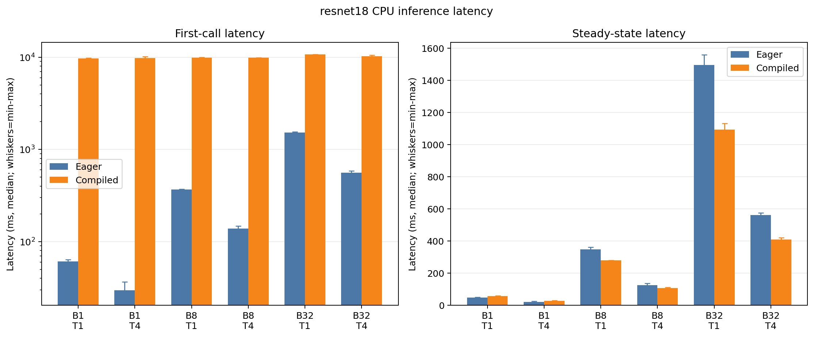
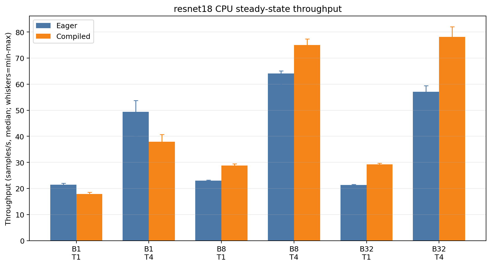
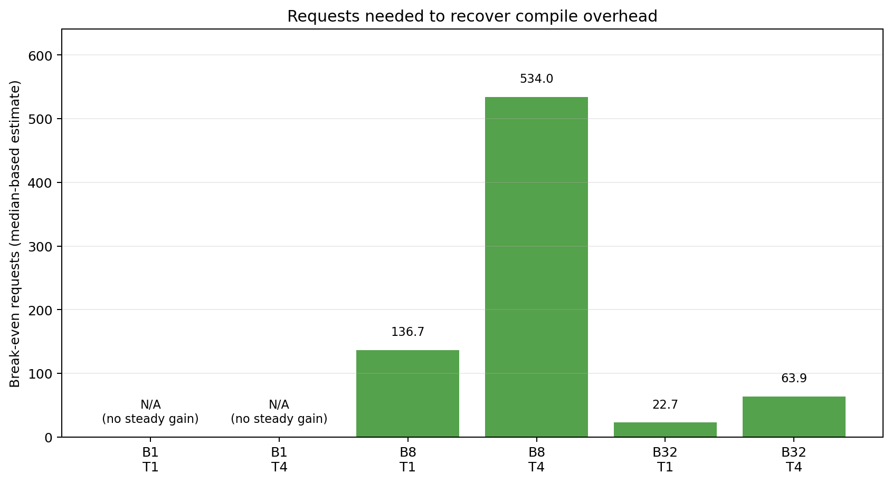

# PyTorch 推理编译性能实验

本项目比较 PyTorch Eager 与默认配置的 `torch.compile` 在 ResNet18 CPU
推理中的首次调用开销、稳态性能和算子结构。实验保留正结果与负结果，不以
“证明编译一定加速”为目标。

## 主要结论

在本项目的 Ubuntu 20.04 VMware 虚拟机上，`torch.compile` 的收益取决于
batch size。每个配置使用 5 次独立重复的中位数：

| Batch size | CPU 线程 | Eager 稳态延迟 (ms) | Compiled 稳态延迟 (ms) | 稳态加速比 | 回本次数 |
| ---: | ---: | ---: | ---: | ---: | ---: |
| 1 | 1 | 46.622 | 56.051 | 0.832x | 不可回本 |
| 1 | 4 | 20.254 | 26.352 | 0.769x | 不可回本 |
| 8 | 1 | 347.652 | 278.104 | 1.250x | 136.7 |
| 8 | 4 | 124.851 | 106.664 | 1.171x | 534.0 |
| 32 | 1 | 1496.273 | 1092.562 | 1.370x | 22.7 |
| 32 | 4 | 560.265 | 409.589 | 1.368x | 63.9 |

- Batch size 1 的两个配置均变慢，因此没有回本点。
- Batch size 8 和 32 获得 `1.171x` 至 `1.370x` 的稳态加速。
- Compiled 首次调用中位数为约 `9.70–10.71 s`。额外编译开销约为
  `9.18–9.78 s`，必须与稳态收益分开讨论。
- 这些数字只适用于下述软硬件、随机输入和统计口径，不代表真实业务的
  端到端推理性能。







## 实验设计

- 模型：`torchvision.models.resnet18(weights=None).eval()`。
- 输入：固定随机种子生成的 `[B, 3, 224, 224]` 张量，不下载数据集。
- 执行模式：PyTorch Eager、默认配置的 `torch.compile`。
- Batch size：`1`、`8`、`32`。
- CPU 线程数：`1`、`4`、机器物理核心数，重复值去重。本机物理核心数为
  4，因此实际线程集合为 `{1, 4}`。
- 每个配置进行 5 次独立测量。Eager 与 compiled 使用新的工作进程；
  每次 compiled 冷启动还使用新的 Inductor 缓存目录。
- 奇数次重复按 Eager→compiled 执行，偶数次按 compiled→Eager 执行，
  避免固定顺序与时间漂移完全重合。
- 正式稳态计时使用 `torch.utils.benchmark.Timer.blocked_autorange()`，
  `min_run_time=1.0 s`。每次计时前进行 5 次预热。
- 正确性检查使用相同权重和输入，在 `torch.inference_mode()` 下比较输出；
  容差为 `rtol=1e-4`、`atol=1e-5`。

汇总使用独立重复的中位数，并保留 min–max 范围。稳态加速比定义为：

```text
steady_speedup = eager_steady_median_ms / compiled_steady_median_ms
```

回本次数定义为：

```text
compile_overhead_ms = compiled_first_median_ms - eager_first_median_ms

break_even_requests = max(0, compile_overhead_ms) /
                      (eager_steady_median_ms - compiled_steady_median_ms)
```

当 compiled 稳态不快于 Eager 时，`break_even_requests` 记为 `null`。

## 实验环境

| 项目 | 正式实验值 |
| --- | --- |
| 操作系统 | Ubuntu 20.04.6，Linux 5.15 |
| 运行方式 | VMware 虚拟机 |
| CPU | Intel Core Ultra 5 125H，VM 分配 4 个物理/逻辑核心 |
| GPU | 无可用 CUDA 设备 |
| Python | 3.12.16 |
| PyTorch | 2.12.1+cpu |
| torchvision | 0.27.1+cpu |
| 编译器 | conda-forge GCC/G++ 13.4.0 |
| Matplotlib | 3.10.9 |

正式环境保存在 `results/environment.json`。`results/conda-linux-64.lock`
记录最终通过复核的可运行 Conda 环境（包括分析阶段加入的 Matplotlib）的
精确包版本，`results/pip-freeze.txt` 记录对应 Python 包版本。基准运行当时
的环境身份以 `results/environment.json` 和原始数据元数据为准。

## 快速验证

以下命令在 Linux 或 WSL2 中运行。项目脚本要求 Conda 环境名为
`ai-infra-compile`，以降低误用其他 Python 环境的风险。

```bash
conda env create -f environment.yml
conda activate ai-infra-compile
```

若新版 Conda 的 ToS 插件要求确认默认源条款，请按终端提示先完成确认。
`environment.yml` 使用 `conda-forge` 与 `nodefaults`，环境求解不从默认源
安装实验依赖。

运行编译冒烟测试：

```bash
scripts/run_in_env.sh python scripts/smoke_compile.py
```

预期关键输出：

```json
{
  "allclose": true,
  "max_abs_error": 0.0,
  "device": "cpu"
}
```

运行完整测试：

```bash
scripts/run_in_env.sh python -m unittest discover -s tests -p "test_*.py" -v
```

不要 `source scripts/env.sh`。`scripts/run_in_env.sh` 只给当前子进程设置
编译器和动态库路径，不会修改调用者终端或其他 Conda 环境。

## 重新运行实验

仓库保留了正式结果，默认命令会拒绝覆盖这些文件。复现实验时使用新的文件
名，可以同时保留原结果和复现结果。

### 1. 采集当前环境

```bash
scripts/run_in_env.sh python collect_environment.py \
  --output results/environment.repro.json
```

环境快照与运行时必须一致。不要用另一台机器的 `environment.json` 冒充当前
环境。

### 2. 最小闭环

先运行 batch size 1、4 线程的一次独立重复：

```bash
scripts/run_in_env.sh python benchmark.py \
  --environment results/environment.repro.json \
  --output results/minimal_repro.csv \
  --metadata-output results/minimal_repro.metadata.json
```

这一步验证 Eager/compiled 正确性、冷启动计时、预热和稳态计时链路。

### 3. 完整 CPU 矩阵

```bash
scripts/run_in_env.sh python benchmark.py --matrix \
  --environment results/environment.repro.json \
  --output results/raw_results.repro.csv \
  --metadata-output results/raw_results.repro.metadata.json
```

若运行中断，保留生成的 `.partial.csv` 和 `.state.json`，然后在原命令末尾
增加 `--resume`。不要修改参数或环境快照后继续同一个 checkpoint。

### 4. Profiler

```bash
scripts/run_in_env.sh python profile_inference.py \
  --environment results/environment.repro.json \
  --output-dir results/profiler_repro
```

Profiler 默认分析 batch size 32、4 线程。编译和预热发生在采样区间之外。
Profiler 数据用于解释瓶颈，不作为正式延迟数据。

### 5. 汇总与绘图

```bash
scripts/run_in_env.sh python analyze.py \
  --input results/raw_results.repro.csv \
  --input-metadata results/raw_results.repro.metadata.json \
  --summary-output results/summary.repro.csv \
  --figures-dir figures/repro \
  --metadata-output results/analysis_metadata.repro.json
```

`analyze.py` 会先验证实验身份、正确性证据和完整矩阵，再生成汇总与图表。
数值汇总应能从相同输入和分析代码重现；PNG 字节可能因字体和渲染栈不同而
变化。

## Profiler 观察

代表性配置为 batch size 32、4 线程，每种模式采样 3 次推理：

| 模式 | 主要自身 CPU 时间 | 观察 |
| --- | --- | --- |
| Eager | `mkldnn_convolution` 81.44%；max pool 9.62%；BatchNorm 5.10%；ReLU 2.06%；残差加法 0.98% | 多类操作以独立事件出现 |
| Compiled | `mkldnn_convolution` 91.54%；生成的 `CompiledFxGraph` 7.83% | 其他单项均低于 0.2% |

两种模式都记录了 60 次 `mkldnn_convolution` 调用，即每次推理 20 次。
编译没有减少卷积层调用数。聚合事件组从 Eager 的 112 个降到 compiled 的
46 个，且 BatchNorm、ReLU 和残差加法不再作为主要独立条目出现。

这些现象与“非卷积工作被合并或下沉到生成代码、调度碎片减少”的解释一致。
但聚合表不能证明每一条具体融合规则。Compiled 后的主要瓶颈仍是卷积。

## 数据与产物

```text
.
├── README.md
├── AGENTS.md
├── environment.yml
├── requirements.txt
├── collect_environment.py
├── benchmark.py
├── profile_inference.py
├── analyze.py
├── scripts/
│   ├── run_in_env.sh
│   └── smoke_compile.py
├── tests/
│   ├── test_benchmark.py
│   ├── test_profile_inference.py
│   └── test_analysis.py
├── results/
│   ├── environment.json
│   ├── raw_results.csv
│   ├── raw_results.metadata.json
│   ├── summary.csv
│   ├── analysis_metadata.json
│   └── profiler/
├── figures/
│   ├── latency.png
│   ├── throughput.png
│   └── break_even.png
└── progress.md
```

- `raw_results.csv` 是正式性能原始数据，共 120 行。
- `summary.csv`、三张图和结论均由 `analyze.py` 从原始数据生成。
- `analysis_metadata.json` 保存输入、分析脚本和输出的 SHA-256。
- `operator_summary.csv` 保存全部按输入 shape 聚合的 Profiler 算子行，没有
  只保留有利的 top-N 条目。

## 负结果与排障记录

以下问题均被保留，没有悄悄切换实验或删除不利数据：

- 原生 Windows 的 Inductor 冒烟测试失败，因为找不到 MSVC `cl.exe`。
  正式实验因此转移到 Ubuntu VM。
- Ubuntu 系统 G++ 9.4 不支持本版 PyTorch 需要的 C++20。项目改用独立
  Conda 环境中的 G++ 13.4，不修改系统编译器。
- 只设置 Conda 编译器但仍加载系统 `libstdc++` 时缺少
  `GLIBCXX_3.4.32`。`run_in_env.sh` 只为实验子进程设置 Conda 动态库路径。
- 初次运行曾继承 ROS 的 `/opt/ros/noetic/lib`，导致环境快照校验失败。
  当前 wrapper 不再继承调用者的无关 `LD_LIBRARY_PATH`。
- Batch size 1 的 compiled 稳态性能低于 Eager，正式结果保留为不可回本。

## 限制

- 模型使用随机初始化权重和随机输入；本实验不测分类精度，也不代表真实
  数据预处理、队列、I/O 或服务框架的端到端延迟。
- 结果来自一台仅分配 4 个 vCPU 的 VMware 虚拟机。宿主机调度和共享资源
  可能影响波动，不能直接外推到服务器或其他 CPU。
- 每组只有 5 次独立重复。报告中位数和 min–max，但样本量不足以描述复杂的
  延迟分布。
- 回本估计假设后续请求保持相同 shape 和稳定的稳态节省；动态 shape、缓存
  复用策略和进程生命周期变化会改变回本点。
- 核心实验只覆盖 CPU、FP32、ResNet18 和默认 `torch.compile`。CUDA、其他
  模型、编译 mode、低精度和量化属于后续扩展。
- Profiler 会引入额外开销，因此 Profiler 墙钟时间没有用于正式性能结论。

## 官方参考

- [torch.compile 端到端教程](https://docs.pytorch.org/tutorials/intermediate/torch_compile_full_example.html)
- [PyTorch Benchmark 教程](https://docs.pytorch.org/tutorials/recipes/recipes/benchmark.html)
- [torch.utils.benchmark API](https://docs.pytorch.org/docs/main/utils/benchmark.html)
- [PyTorch Profiler 教程](https://docs.pytorch.org/tutorials/recipes/recipes/profiler_recipe.html)

